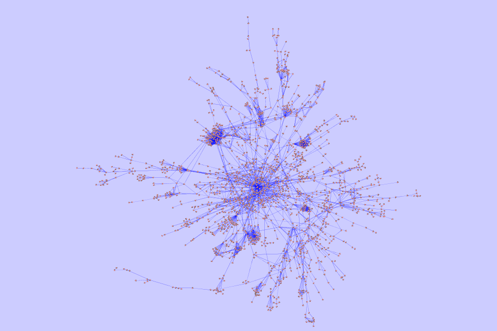
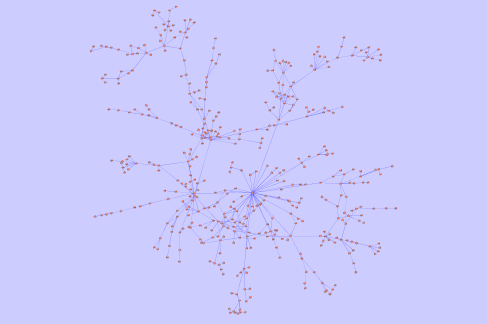
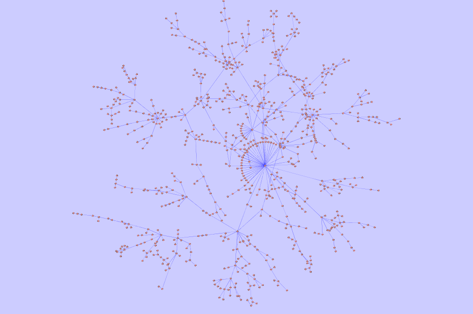
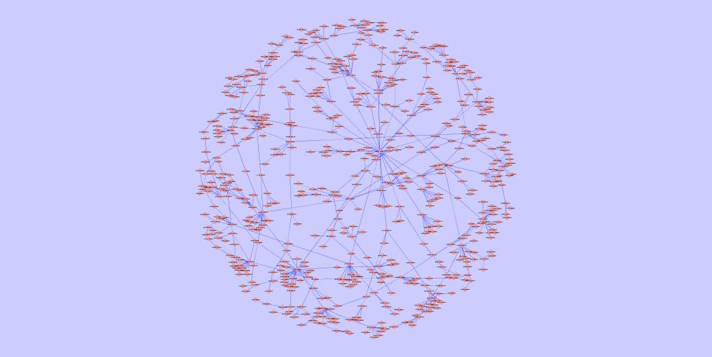
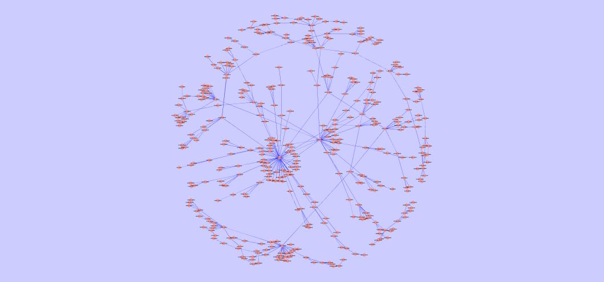
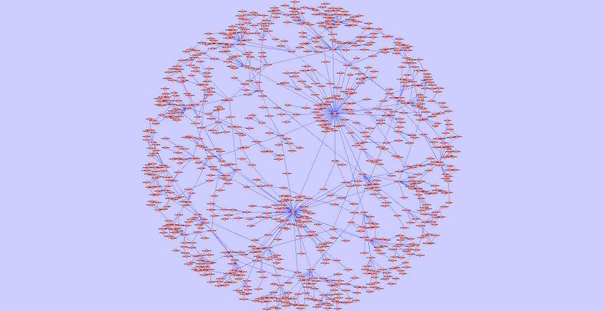

<div align="center">


# C-GRAAL: Common-Neighbors-Based Global GRAph ALignment Algorithm

**Supplementary material**

**Vesna Memišević and Nataša Pržulj**

Corresponding author: Prof. N. Pržulj, natasa.przulj@mbzuai.ac.ae

</div>

## Downloads

**About**
- V. Memišević and N. Pržulj. C-GRAAL: Common-neighbors-based global GRAph ALignment of biological networks. *Integrative Biology* 4, 734–743 (2012). [PMID: 22234340](https://pubmed.ncbi.nlm.nih.gov/22234340/)
- [Supplementary material (PDF)](Supplementary_Material/C-GRAAL%28SupplementaryMaterial%29.pdf)

**Executables**
- [C-GRAAL (Unix64 version)](Executables/CGRAAL_unix64)
- [list2leda](Executables/list2leda)

**Networks**
- [Yeast-Human](Networks/yeast_human.zip)
- [Human-Pathogen](Networks/human-pathogen.zip)
- [Bacteria](Networks/bacteria.zip)
- [Herpesviruses](Networks/virus.rar)

**Alignments**
- [Best alignments](Alignments/best_alignments.xlsx)

**Predictions**
- [Yeast - Human](Predictions/predictions_Yeast_Human.xlsx)
- [*F. tularensis* - *H. sapiens*](Predictions/FH_predictions.xlsx)
- [*B. anthracis* - *H. sapiens*](Predictions/BH_predictions.xlsx)
- [*Y. pestis* - *H. sapiens*](Predictions/YH_predictions.xlsx)
- [*C. jejuni* - *E. coli*](Predictions/predictions_ECL_CJJ.xlsx)
- [*Mesorhizobium loti* - *Synechocystis* sp. PCC6803](Predictions/predictions_SPP_MZL.xlsx)

## How to run C-GRAAL

- Download `CGRAAL_unix64` from the link above. C-GRAAL accepts networks in LEDA `.gw` format.
- Run `./CGRAAL_unix64` without parameters to see usage directions.

Usage:
```bash
./CGRAAL_unix64 net1.gw net2.gw similarity.file output1.file output2.file
```
- `net1.gw`: first network (`.gw` format)
- `net2.gw`: second network (`.gw` format)
- `similarity.file`: similarity between nodes in net1 and net2, in the format `nodeXNet1 nodeYNet2 similarity`
- `output1.file`: alignment output as `node_Net1 node_Net2`, with nodes as numbers
- `output2.file`: alignment output as `node_Net1 node_Net2`, with nodes as names

> [!IMPORTANT]
> The number of nodes in the first network must not be greater than the number of nodes in the second network.

If you get a "permission denied" error, run `chmod +x CGRAAL_unix64` first.

## Converting an edge list to `.gw`

If your network is an edge list:
```
node1 node2
node3 node4
...
```
convert it with the `list2leda` script:
```bash
./list2leda edgelist.txt >> graph.gw
```
Self-loops, edge directions and duplicate edges are ignored.

## Figures

The largest common connected component of the best alignment for each pair:

<table>
  <tr>
    <td align="center"><br>Yeast - Human</td>
    <td align="center"><br><i>C. jejuni</i> - <i>E. coli</i></td>
    <td align="center"><br><i>M. loti</i> - <i>Synechocystis</i> sp. PCC6803</td>
  </tr>
  <tr>
    <td align="center"><br><i>F. tularensis</i> - <i>H. sapiens</i></td>
    <td align="center"><br><i>B. anthracis</i> - <i>H. sapiens</i></td>
    <td align="center"><br><i>Y. pestis</i> - <i>H. sapiens</i></td>
  </tr>
</table>

## Other network alignment algorithms

- [GRAph ALigner (GRAAL)](https://github.com/przulj-lab/GRAAL)
- [MI-GRAAL](https://github.com/przulj-lab/MI-GRAAL)
- [IsoRank and IsoRankN](https://cb.csail.mit.edu/cb/mna/)
- [PathBlast](https://karlan.com/)
- [GraphM package](https://www.minesparis.psl.eu/cbio/)
- [Natalie](https://www.mi.fu-berlin.de/w/LiSA/Natalie)

## Notes

All p-values in the paper were calculated with MATLAB 2007. Newer MATLAB versions use a different output precision, so their p-values may differ from those obtained with the 2007 version (e.g. old version: 1.7E-9, newer version: 0.0).
